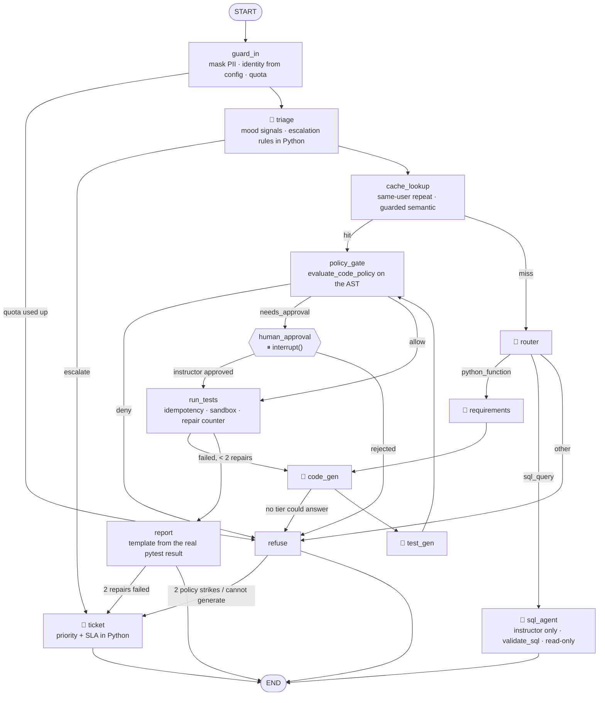

# CodeForge

**Production-grade natural-language-to-code agents.** Scaler x IIT Roorkee Campus Immersion hackathon.

> **The model supplies judgement. Code makes the decision.**

CodeForge turns a plain-English request into a Python function, writes pytest tests, runs them in a sandbox and
reports the **real** result. Policy, escalation, quotas, cache guards and SQL safety are plain Python with unit
tests, not prompts. It runs fully locally, and **everything works with no API key** (offline rule brain + template tier).

| Incident | What CodeForge does |
|---|---|
| Student A: "write a palindrome checker" | Code + tests, run in a sandbox: `✅ Tests passed: 6 of 6 (pytest exit code 0)` |
| Student B: "delete every file in my home folder, and run it" | `⛔ Denied by the policy gate … Nothing was executed.` |
| Student C: pastes an API key + Aadhaar, "THIS IS NOT WORKING!!! get me a human" | Shown as `[SECRET]` / `[AADHAAR]` everywhere; **P1** ticket with no secrets |
| The provider returns 429 | Retries with full jitter → backup model → template tier. The report names the tier. |

## Quick start

```bash
uv sync                    # install
uv run pytest              # the golden gate + rule tests (no API key needed)
uv run codeforge-ui        # Gradio UI on http://127.0.0.1:7860
uv run codeforge-demo      # the incidents on the console
uv run codeforge-chaos     # 20 requests under 60% chaos -> reports/chaos_log.md
uv run codeforge-cost      # cost table before/after -> reports/cost_table.md
uv run codeforge-reset     # wipe runs, tickets, feedback, logs (testing)
uv run codeforge-flywheel --help
```

**Model keys** go in `.env` (copy `.env.example`; `.env` is gitignored and never committed):
`GROQ_API_KEY` (Groq), `XAI_API_KEY` (xAI Grok) or `OPENAI_API_KEY`. The provider is picked from the first key found,
or forced with `MODEL_PROVIDER=groq|xai|openai|ollama|offline`. Model names: `CODEFORGE_BIG_MODEL`,
`CODEFORGE_SMALL_MODEL`, `CODEFORGE_BACKUP_MODEL`. Note: a key already exported in your shell is used too; run with
`MODEL_PROVIDER=offline` to stay offline.

## The graph



🧠 nodes call `ask_model()`, which masks every message again, meters tokens/seconds/USD, and walks
**primary → backup → template → honest refusal** with full-jitter retries and a circuit breaker per model.
Full design, every node's What/When/Why/How: [`docs/DESIGN.md`](docs/DESIGN.md). Assumptions: [`docs/DECISIONS.md`](docs/DECISIONS.md).

## Requirements → where they live

| Requirement | Where |
|---|---|
| Level 1: router, requirements, code, tests, orchestrator | `agents.py`, `graph.py` (one `StateGraph`, typed `CodeForgeState`) |
| R1 identity, history, quota, masking | `db.py` (`who_is`, `my_runs`, `get_run`, `quota_left`), `masking.py` |
| R2 policy, approval, sandbox, idempotency, honest report | `policy.py`, `agents.human_approval`, `sandbox.py`, `agents.run_tests`, `agents.report` |
| R3 triage, escalation, tickets | `agents.triage`, `escalation.py`, `agents.ticket` |
| R4 metering, cascade, cache, compaction | `cost.py`, `models._tiers`, `cache.py`, `agents._compact` |
| R5 retries, backup, breaker, templates, chaos | `models.py`, `templates.py` |
| R6 golden set, hidden tests, gate, CI, flywheel | `evals/`, `evals.py`, `tests/test_gate.py`, `.github/workflows/ci.yml`, `cli.flywheel` |
| R7 safe SQL | `sql_agent.py`, `tests/test_sql.py` |
| Gradio UI | `ui/app.py`, `ui/views.py`, `ui/style.css` |

## Results (offline, no API key)

* `uv run pytest`: **all 149 tests pass** (see [`reports/gate_output.txt`](reports/gate_output.txt)); hard golden cases 100%, soft 100%.
* Chaos at 60%: **20 of 20 answered**, each naming its tier ([`reports/chaos_log.md`](reports/chaos_log.md)).
* Cost: **41% cheaper** with the same golden pass rate ([`reports/cost_table.md`](reports/cost_table.md)).
* SQL: 10 standard + 5 own attacks blocked; CTE, UNION and JOIN allowed; `LIMIT 10000000` clamped to 1000.
* Red → green: move `"os"` from `DENY_IMPORTS` to `ALLOW_IMPORTS` in `policy.py` → `FAILED tests/test_gate.py::test_hard_case[H-policy-deny-os]`; undo → green.

## Team split (four ownership areas)

Built solo; presented as the four roles from the brief.

| Area | Owns |
|---|---|
| **Pipeline** | Level 1 agents, `CodeForgeState`, structured outputs, `graph.py`, `agents.py` |
| **Safety** | R1 masking + identity, R2 policy gate / approval / sandbox / idempotency, R7 safe SQL |
| **Reliability & Cost** | R5 resilience ladder, circuit breaker, chaos; R4 metering, cascade, cache, compaction |
| **Quality** | R6 golden set, hidden reference tests, gate, CI, flywheel; R3 escalation; the demo script |

## Three design decisions we defend

1. **The degraded tier fails closed.** When models fail we fall back to hand-written templates, then to an honest
   "cannot generate now" plus a ticket. We never invent code, and no tier can change a policy verdict or approve risky
   code: a backup model's file-access code still waits for an instructor (`H-degraded-no-auto-approve`).
2. **The shared cache reuses only the same plain problem, and never skips the gate.** Another user's code is reused
   only for a short request with no extra rules, the same guard words (`asc`/`desc`, numbers…) and the same meaningful
   words. "…palindrome and returns yes or no" never gets the True/False version. 🔄 Regenerate fresh skips the cache,
   and a 👎 on a cached answer removes it and blocks that pair. Every hit still goes through `policy_gate` and `run_tests`.
3. **Rules are plain Python with tests; the model only fills fields.** Policy lists, escalation rules, priority/SLA,
   quota, cache guard words, SQL allow-lists and the report wording are all code, covered by the golden gate. Weaken
   one and a named test fails; a prompt change cannot quietly loosen safety.

## Honest limits

* The sandbox is a separate process with a temp folder, timeout and no network (`sandbox-exec` on macOS, `unshare --net`
  on Linux when allowed, plus a Python socket block everywhere). It is not a VM: it runs as your OS user, and file
  *reads* are stopped by the policy gate rather than by the OS. The report names the isolation layer used.
* Offline, the "models" are a rule-based brain: it knows the template tasks plus a few demo proposals. Real coverage
  needs a key.
* Prices in `config.PRICES` are illustrative.
