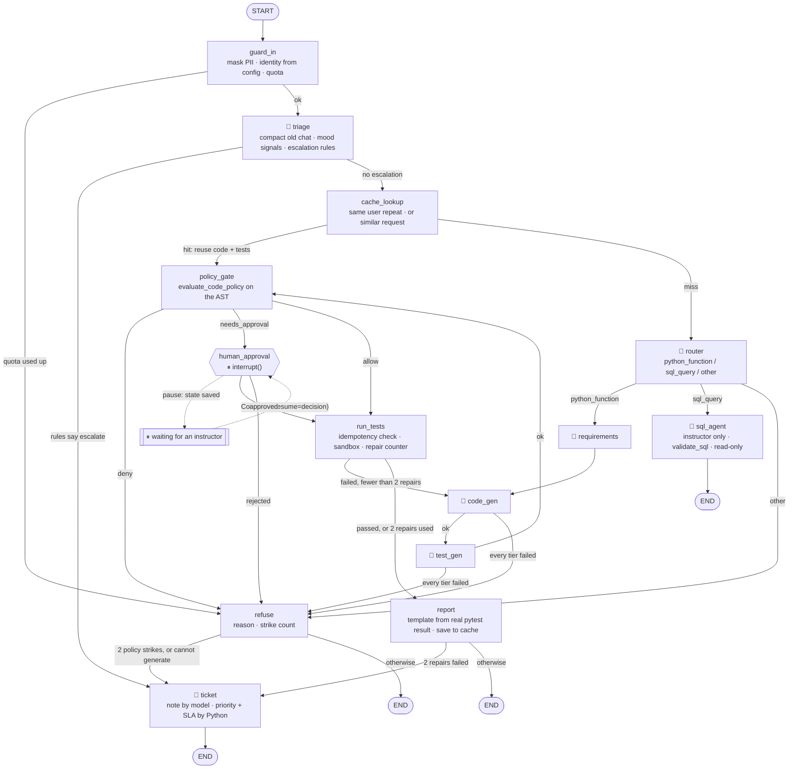
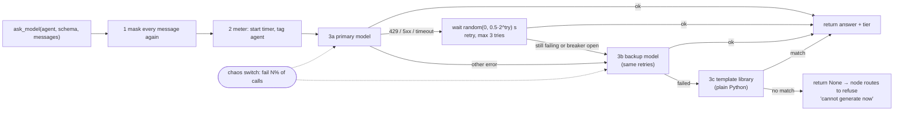
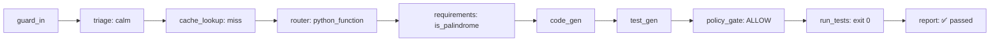
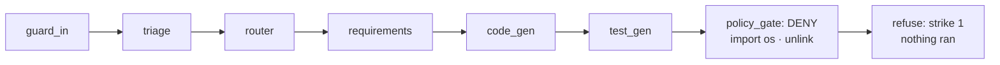
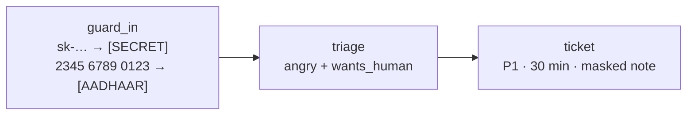
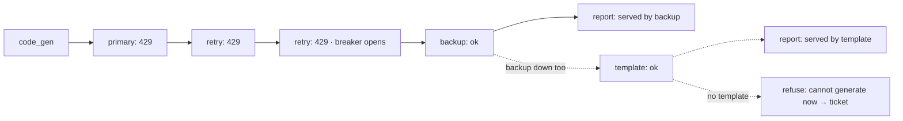

# CodeForge: Design (simple version)

> **The model supplies judgement. Code makes the decision.**
>
> Status: **Approved and built** (Phase 2). Changes made while building are listed in [DECISIONS.md](DECISIONS.md).

This version keeps **every requirement and pass condition** from the brief, but uses fewer moving parts:

- **14 nodes instead of 21.** Small helper steps (masking, the idempotency check, the repair counter) now live *inside* the node that uses them.
- **One flat folder** of plain Python files. No sub-packages except the UI.
- **One helper for every model call:** `ask_model(...)`. It does masking, metering, retries, backup and templates in one place. Nodes stay short.
- **Plain functions and dicts.** Pydantic is used only where the brief asks for structured output.

---

## 0. Words you will meet

| Term | One-line meaning |
|---|---|
| **LangGraph** | A library that runs Python functions ("nodes") one after another, passing one shared state between them. |
| **Node** | One step. A plain function `node(state, config) -> dict` that returns only the fields it changed. |
| **Conditional edge** | An arrow whose next node is chosen by a tiny Python function that reads the state. |
| **Typed state** | A `TypedDict` listing every field the graph can carry. |
| **Structured output** | The model fills a Pydantic object with fixed fields, instead of writing free text. |
| **AST** | Abstract Syntax Tree: Python code read as a tree (imports, calls, names) **without running it**. |
| **`interrupt()`** | A LangGraph call that pauses the graph and saves its state until someone resumes it with `Command(resume=...)`. |
| **Sandbox** | A locked-down run: separate process, temp folder, time limit, no network. |
| **Idempotency** | Doing the same thing twice has the same effect as once. Here: the same code + tests run only once. |
| **Full-jitter backoff** | After a failure, wait a *random* time between 0 and a limit that doubles each try, so clients don't all retry together. |
| **Circuit breaker** | A per-model switch. After 3 failures in a row we stop calling that model for 30 s, then try one call again. |
| **Model cascade** | A cheap small model for easy steps, a big model only for writing code and tests. |
| **Semantic cache** | Reuse an earlier answer when a new request *means* the same thing (measured with embeddings). |
| **Guard words** | Words that change the answer ("ascending" vs "descending"). Two requests must share them to share a cache entry. |
| **TTL** | Time to live: how long a cache entry stays valid. |
| **Tier** | Who produced the answer: `primary` model, `backup` model, `template` library, or `none` (honest refusal). |
| **Golden set** | A fixed list of test cases that must keep passing. It is our quality gate. |

---

## 1. Overview

CodeForge turns an English request into a Python function, writes pytest tests for it, runs them in a sandbox and reports the **real** result.

1. `guard_in` masks secrets and personal data, and reads who the user is from `config`.
2. `triage` reads mood and urgency. Python rules decide if a human should take over.
3. The Level 1 agents (`router`, `requirements`, `code_gen`, `test_gen`) build code and tests.
4. `policy_gate` reads the code's AST. **deny** → refused. **needs_approval** → the graph pauses for an instructor. **allow** → it runs.
5. `run_tests` runs it once in a sandbox. `report` fills a template from the real pytest exit code.

Every model call goes through `ask_model`, which falls back from primary → backup → template → honest refusal.

### The four incidents

| Incident | Path | Outcome |
|---|---|---|
| **Student A**: palindrome | `guard_in → triage → cache_lookup → router → requirements → code_gen → test_gen → policy_gate → run_tests → report` | Code, tests, "✅ Tests passed: 6 of 6 (pytest exit code 0)". |
| **Student B**: delete my home folder, run it | `… → test_gen → policy_gate (deny) → refuse` | "⛔ Denied: imports `os`, calls `unlink`. Nothing was executed." Strike 1. |
| **Student C**: key + Aadhaar + "THIS IS NOT WORKING!!! get me a human" | `guard_in (masks) → triage (escalate) → ticket` | Chat shows `[SECRET]`, `[AADHAAR]`. **P1** ticket, no secrets in it. |
| **429 errors** | Same as Student A. Inside `ask_model`: retry → breaker opens → backup → template. | Still answered. Report says "Served by: backup" (or template). Unknown task in a full outage → "cannot generate now" + ticket. |

---

## 2. Diagrams

### 2.1 Main graph

🧠 = calls a model through `ask_model`. Everything else is plain Python.



### 2.2 Inside `ask_model` (the wrapper around every 🧠 node)



### 2.3 Incident paths

**Student A**



**Student B**



**Student C**



**429 errors**



---

## 3. Typed state: `CodeForgeState`

`guard_in` resets the "turn" fields at the start of each message. "Thread" fields are kept between messages in the same chat (saved by `MemorySaver`). Identity is **not** in the state; it is only in `config`.

| Field | Scope | Written by | Read by |
|---|---|---|---|
| `messages` (list, `add_messages`) | thread | `guard_in` (masked user msg), `triage` (removes old msgs), `report`, `refuse`, `ticket`, `sql_agent` | `triage`, UI |
| `summary` (str) | thread | `triage` (compaction) | `triage`, `ticket` |
| `unhappy_streak` (int) | thread | `triage` | `triage` |
| `strikes` (int, policy denials) | thread | `refuse` | `refuse`, `triage` |
| `request` (str, masked) | turn | `guard_in` | all agents, `cache_lookup`, `ticket` |
| `pii_found` (list) | turn | `guard_in` | `cache_lookup`, `report`, UI |
| `blocked` (str: `""`/`"quota"`) | turn | `guard_in` | edge after `guard_in` |
| `triage` (dict) | turn | `triage` | edges, `ticket` |
| `escalate_reason` (str) | turn | `triage`, `refuse`, `report` | edges, `ticket` |
| `route` (str) | turn | `router` | edge after `router` |
| `requirements` (dict) | turn | `requirements`, `cache_lookup` | `code_gen`, `test_gen`, `report` |
| `code`, `tests` (str) | turn | `code_gen`, `test_gen`, `cache_lookup` | `policy_gate`, `human_approval`, `run_tests`, `report` |
| `served_by` (dict agent → tier) | turn | every 🧠 node | `report`, UI |
| `cache_hit` (bool) | turn | `cache_lookup` | `report`, UI |
| `policy` (dict: verdict, reasons) | turn | `policy_gate` | edges, `refuse`, `human_approval`, UI |
| `approved` (bool) | turn | `human_approval` | edge after it |
| `run` (dict: exit_code, passed, total, timed_out, first_failure, reused, key) | turn | `run_tests` | `report`, `code_gen` (repair), edges |
| `attempts` (int, repairs used) | turn | `run_tests` | edges, `report`, `ticket` |
| `refusal` (dict: kind, reason) | turn | `refuse` | edges, UI |
| `ticket` (dict: id, priority, sla, note) | turn | `ticket` | UI |
| `sql` (dict: sql, ok, reason, rows) | turn | `sql_agent` | UI |
| `answer` (str, final text) | turn | `report`, `refuse`, `ticket`, `sql_agent` | console, UI |

---

## 4. Node by node (What / When / Why / How)

### 4.1 `guard_in`: masking and quota
- **What:** masks secrets and PII in the new message, reads identity, checks quota, resets the turn fields.
- **When:** first, on every message. Next: `triage`, or `refuse` if the quota is used up.
- **Why:** R1. If raw text reaches the model or a log once, we fail. Masking first means every later step sees only clean text.
- **How:** plain Python.
  1. `clean, found = mask(text)` (in `masking.py`).
  2. Replace the user message with the masked copy (same message id).
  3. `user_id, role = who_is(config)`. Unknown role → `student`.
  4. Count this user's sandbox runs in the last 24 h. Students 20, instructors 100. Over → `blocked = "quota"`.
  5. `log_event("turn_in", user=user_id, text=clean)`.

**Masking rules** (applied in this order; each has a unit test, plus one "must NOT mask" test):

| Kind | Rule | Becomes | Must NOT mask |
|---|---|---|---|
| API key | `sk-…`, `sk-proj-…`, `gsk_…` (16+ chars) | `[SECRET]` | "sk-learn" |
| Email | `name@domain.tld` | `[EMAIL]` | |
| Card | 13–19 digits **and** passes the Luhn check | `[CARD]` | "ref 1234567890123456" (fails Luhn) |
| Aadhaar | 12 digits, first digit 2–9, groups of 4 optional | `[AADHAAR]` | "order 12345678" |
| Phone | Indian mobile `(+91)?[6-9]` + 9 digits | `[PHONE]` | "fib(30) = 832040" |

### 4.2 `triage` (includes compaction and the escalation rules)
- **What:** one structured model call that returns `task_type, language, sentiment, urgency, wants_human`. Then Python rules decide whether to escalate.
- **When:** after `guard_in`. Next: `ticket` (escalate) or `cache_lookup`.
- **Why:** R3: one triage call; code, not the model, decides. R4: compaction keeps prompts small.
- **How:**
  1. **Compaction:** if the chat has more than 12 messages, summarise all but the newest 4 with the small model, store it in `summary`, and delete the old messages.
  2. `t = ask_model("triage", Triage, messages)`. Offline/template: keyword rules (`!!!`, mostly capitals, "useless" → angry; "not working", "still failing" → negative; "deadline", "tonight", "asap" → urgency 5; "human", "person", "mentor" → wants_human).
  3. `unhappy_streak` = +1 if sentiment is negative or angry, else 0.
  4. `escalate_reason = should_escalate(t, unhappy_streak, strikes)` from `escalation.py`:

| Rule (first match wins) | Reason |
|---|---|
| `wants_human` | user asked for a human |
| sentiment `angry` | user is angry |
| sentiment `negative` and urgency ≥ 4 | unhappy and urgent |
| `unhappy_streak >= 2` | two unhappy turns in a row |
| `strikes >= 2` | repeated policy denials |

  The other two triggers (two denials in this turn, two failed repairs) are set by `refuse` and `report` using the same file.

### 4.3 `cache_lookup`
- **What:** reuse code + tests from an earlier request. (1) Same user, exact same masked text, in the last 10 min. (2) Any user, similar meaning, same guard words, in the last hour.
- **When:** after `triage`. Next: `policy_gate` on a hit, `router` on a miss.
- **Why:** R4 saves money. Rule (1) also makes "same request twice runs once" work with a real model, which may write slightly different code each time.
- **How:** plain Python + embeddings (section 5.5). A hit skips only the model steps. **It never skips the policy gate or the sandbox.**

### 4.4 `router` (Router/Parser agent)
- **What:** `RouteDecision(kind, language)`, kind = `python_function`, `sql_query` or `other`.
- **When:** cache miss. Next: `requirements`, `sql_agent` or `refuse` (kind "other").
- **Why:** Level 1 needs a separate router with structured output.
- **How:** small model. Python rule after it: any language other than Python (and not SQL) → `other`, since we can only test Python. No language named → Python.

### 4.5 `requirements` (Requirements agent)
- **What:** `Requirements(function_name, params, returns, edge_cases, examples)`.
- **When:** after `router`. Next: `code_gen`.
- **Why:** Level 1. Code and tests are built from the same spec, so the names match.
- **How:** small model. Python check: `function_name` must be a valid identifier, else we build one from the request.

### 4.6 `code_gen` (Code Generation agent)
- **What:** writes `solution.py` with the function.
- **When:** after `requirements`, or again after a failed run (repair). Next: `test_gen`, or `refuse` if every tier failed.
- **Why:** Level 1.
- **How:** big model, `GeneratedCode(code)`. The prompt says: standard library only, no files, no network, no input(). On a repair, the prompt also gets the failing test and error from `run["first_failure"]`. Python checks: strip ``` fences; `ast.parse` must work, else it counts as a failed call and `ask_model` moves to the next tier.

### 4.7 `test_gen` (Test Generation agent)
- **What:** writes `test_solution.py` with 4–8 pytest tests that import from `solution`.
- **When:** after `code_gen`. Next: `policy_gate`, or `refuse`.
- **Why:** Level 1 (mandatory). These tests show behaviour to the student. Our *quality gate* uses our own hidden tests instead (section 6), because model tests can be wrong.
- **How:** big model, `GeneratedTests(tests)`. Python check: it parses, imports the function, and has at least one `def test_`.

### 4.8 `policy_gate`
- **What:** runs `evaluate_code_policy(code)` on the code and on the tests. Returns `allow`, `needs_approval` or `deny`, with reasons.
- **When:** after `test_gen` or a cache hit. Next: `run_tests`, `human_approval` or `refuse`.
- **Why:** R2. It is the line between "the model suggested it" and "the computer runs it".
- **How:** a pure function in `policy.py`. It calls `ast.parse` and walks the tree. **It never runs the code.** The worst finding wins: deny > needs_approval > allow.

| | Imports | Builtin calls | Method / attribute names |
|---|---|---|---|
| **allow** | `math, statistics, functools, itertools, operator, collections, heapq, bisect, re, string, typing, dataclasses, enum, decimal, fractions, random, datetime, time, json, copy` (+ `pytest`, `solution` in tests) | everything not listed below | everything not listed below |
| **needs_approval** (files or network) | `pathlib, glob, tempfile, csv, sqlite3, socket, urllib, http, requests, httpx, asyncio, smtplib, ftplib` | `open` | `read_text, write_text, read_bytes, write_bytes, iterdir, mkdir` |
| **deny** | `os, sys, subprocess, shutil, ctypes, multiprocessing, threading, signal, importlib, builtins, inspect, pickle, marshal, platform` **and any module not in the lists** | `eval, exec, compile, __import__, globals, locals, vars, breakpoint` | `unlink, rmdir, rmtree, chmod, system, popen, kill, expanduser, home`, and dunder escapes `__globals__, __builtins__, __subclasses__, __bases__, __code__` |

`while True: pass` is **allowed** by the gate on purpose. The sandbox timeout must catch it (that is a pass condition). `list.remove` stays allowed; `os.remove` is already blocked because `os` is denied.

### 4.9 `human_approval` (interrupt and resume)
- **What:** pauses the graph until a human decides.
- **When:** verdict `needs_approval`. Next: `run_tests` (approved) or `refuse` (rejected).
- **Why:** R2: nothing runs until the approver resumes.
- **How:**
  1. `decision = interrupt({"code": code, "reasons": policy["reasons"]})`. The graph stops and returns. The console/UI shows the code and reasons. **No run has happened.**
  2. The approver calls `resume(app, {"approved": True}, thread=..., role="instructor")` → `app.invoke(Command(resume=decision), config)`.
  3. Approval counts only if the resuming `config` has role `instructor`. There is no auto-approve anywhere, in any tier.

### 4.10 `run_tests` (idempotency check + sandbox + repair counter)
- **What:** runs pytest once, safely, and records the true result.
- **When:** after `policy_gate` (allow) or `human_approval` (approved). Next: `code_gen` (repair) or `report`.
- **Why:** R2: separate process, temp folder, timeout, no network, run once.
- **How:** plain Python, in three steps:
  1. **Idempotency.** `key = sha256(user_id + code + tests)`. If a `Run` row with this key exists, reuse it (`reused = True`) and run nothing.
  2. **Sandbox** (`sandbox.py`):
     - Make a temp folder. Write `solution.py`, `test_solution.py`, and a `conftest.py` that makes `socket.connect` raise an error.
     - Run `python -I -m pytest -q --junitxml=result.xml` in that folder with `subprocess`, a fresh tiny environment (no API keys), and `HOME` set to the temp folder.
     - **macOS:** wrap it with `sandbox-exec` and a profile that denies all network and allows writes only inside the temp folder. (Tested on this Mac, macOS 26.5: network blocked, writes to the home folder blocked.)
     - **Linux:** wrap it with `unshare --net` when allowed; otherwise only the `conftest.py` socket block applies.
     - **Timeout:** 10 s. On timeout we kill the whole process group and record `timed_out = True`.
     - Counts and the first failure come from `result.xml`. The exit code comes from the process. Save a `Run` row. Delete the folder.
  3. **Repair counter.** If the run failed and fewer than 2 repairs were used: `attempts += 1` and go back to `code_gen` (then `test_gen`, then `policy_gate` again: repaired code is re-checked). After 2 failed repairs: go to `report`, which opens a ticket.

**Honest limits:** not a VM, same OS user; file *reads* are stopped by the policy gate, not the OS; `sandbox-exec` is deprecated by Apple but still works; the Python socket block alone could be bypassed by native code, which is why `ctypes`, `os` and unknown modules are denied first. The report names which network block was active.

### 4.11 `report`
- **What:** the final answer, filled from a template.
- **When:** after `run_tests`. Next: `END`, or `ticket` after 2 failed repairs.
- **Why:** R2: "tests passed" appears **only** when pytest exited 0.
- **How:** plain Python. Templates:
  - `✅ Tests passed: {passed} of {total} (pytest exit code 0, {sec} s).`
  - `❌ Tests failed: {passed} of {total} (exit code {code}). First failure: {name}.`
  - `⏱ Timed out after 10 s. The run was killed. No result.`
  - Always adds: `Served by: {tiers}` · `Run key: {key}` · `↻ reused previous run` when reused.
  - If the run passed and the request is cacheable, save code + tests to the cache.

### 4.12 `refuse` (refusals and strikes)
- **What:** one node for every "no": policy deny, rejected approval, quota, "other" requests, and "cannot generate now".
- **When:** from `guard_in`, `router`, `code_gen`, `test_gen`, `policy_gate`, `human_approval`. Next: `ticket` or `END`.
- **Why:** the user always gets a clear reason; repeated denials (R3) and honest refusals (R5) open tickets.
- **How:** plain Python. `kind` decides the text. Only `policy_deny` adds a strike. A ticket opens when `strikes >= 2` or `kind == "cannot_generate"`. Policy refusals always end with "Nothing was executed."

### 4.13 `ticket`
- **What:** opens a ticket with priority, SLA and a handoff note.
- **When:** from `triage`, `refuse` or `report`. Next: `END`.
- **Why:** R3 (handoff with request, attempts, last failing test) and R5 (refusal + ticket).
- **How:** small model writes a short note. **Python** sets priority and SLA, adds the facts, and masks the whole note again before saving:

| Priority | When | SLA |
|---|---|---|
| **P1** | angry **and** wants a human, or urgency ≥ 4 and (angry or wants a human) | 30 min |
| **P2** | angry, negative, wants a human, 2 denials, 2 failed repairs | 4 h |
| **P3** | anything else (e.g. cannot generate now) | 24 h |

### 4.14 `sql_agent` and `validate_sql`
- **What:** turns an instructor's question into a safe SELECT, checks it, runs it read-only.
- **When:** router says `sql_query`. Next: `END`.
- **Why:** R7 bonus.
- **How:**
  1. Role from `config` must be `instructor`. Otherwise: "The SQL agent is for instructors only." Typing "I'm an instructor" changes nothing.
  2. Big model writes `SQLQuery(sql)`. The prompt shows only `sales` and `employees`.
  3. `validate_sql(sql)` with **sqlglot**:
     - exactly one statement;
     - only SELECT (a CTE `WITH … SELECT` and `UNION` are fine); no INSERT/UPDATE/DELETE/DROP/ATTACH/PRAGMA anywhere;
     - tables only from `{sales, employees}` (plus CTE names); `users` and `sqlite_master` are blocked;
     - functions only from `COUNT, SUM, AVG, MIN, MAX, ROUND, ABS, LOWER, UPPER, LENGTH, COALESCE, SUBSTR, DATE, STRFTIME`;
     - no LIMIT → add `LIMIT 100`; LIMIT above 1000 → **clamp to 1000** (so 10,000,000 becomes 1000).
  4. Run with `sqlite3.connect("file:data/sample.db?mode=ro", uri=True)` (read-only, second layer).
  5. Sample DB: `sales`, `employees`, and `users` (fake names, emails, phones, Aadhaar).
  6. Tests: 10 standard attacks (DROP, DELETE, UPDATE, INSERT, `SELECT * FROM users`, `SELECT 1; DROP …`, UNION with users, ATTACH, PRAGMA, sqlite_master) + 5 of ours (CTE reading users, subquery on `"UsErS"`, `load_extension()`, a stacked query hidden after a comment, a non-number LIMIT). Plus allowed cases: aggregate, JOIN, CTE, UNION, clamped LIMIT.

---

## 5. Cross-cutting pieces

### 5.1 Identity and run history
- `chat(app, text, user_id=..., role=..., thread=...)` puts identity into `config["configurable"]`. The UI dropdown picks `u_alice` (student), `u_bob` (student) or `u_carol` (instructor). The message text can never change it.
- `my_runs(config)` and `get_run(run_id, config)` take **no user argument**. They read the user from `config`. `get_run` returns `None` for "missing" **and** for "not yours", and the UI shows the same "Run not found." for both.

### 5.2 Logging only after masking
- `log_event(kind, **fields)` masks every text field before saving it (memory list + `EventLog` table).
- A test runs Student C and checks the raw key and Aadhaar are in **none** of: model prompts (recorded by the meter), logs, the ticket, generated code, chat history.

### 5.3 Model tiers and circuit breaker (`models.py`)
- **Provider:** `MODEL_PROVIDER` env (`openai | groq | ollama | offline`). If not set: OpenAI if `OPENAI_API_KEY`, else Groq if `GROQ_API_KEY`, else offline. Model names come from env (`CODEFORGE_BIG_MODEL`, `CODEFORGE_SMALL_MODEL`, `CODEFORGE_BACKUP_MODEL`); prices from a `PRICES` dict.
- **Offline brain:** with no key, `RuleBasedChat` (from the notebook) plays the primary and backup models. It uses keyword rules and the template library, so the app and all tests work without a key.
- **Retries:** only 429, 5xx and timeouts. Up to 3 tries per model. Wait `random.uniform(0, min(4, 0.5 * 2**try))` seconds (full jitter). Other errors skip straight to the next tier.
- **Circuit breaker:** a small dict per model: `{"fails": 0, "open_until": 0}`. 3 failures in a row → skip this model for 30 s. After that, one call is allowed; success resets it.

### 5.4 Template tier (`templates.py`)
A dict of known tasks, each with `keywords`, `requirements`, `code` and `tests`: **palindrome, factorial, fibonacci, fizzbuzz, list/tuple sum (the Level 1 example), reverse string, is prime, sort ascending, sort descending, max of list, count vowels, gcd**. In a total outage these still return code and tests. Anything else gets an honest "cannot generate now" + ticket.

### 5.5 Metering, cascade and semantic cache
- **Meter** (`cost.py`, a LangChain `BaseCallbackHandler` from the notebook): records tokens, seconds and dollars per agent.
- **Cascade:** small model for `triage, router, requirements, ticket` (and compaction); big model for `code_gen, test_gen, sql_agent`.
- **Cache** (`cache.py`), two layers:
  - **Repeat** (same user, same masked text, 10 min): always safe; stored for every passing run.
  - **Shared / semantic** (any user, 1 h): reuses another user's code + tests only through four locks:
    1. **plain request**: no PII, no personal words (`my`, `this`, `fix`…), no extra-rule connectors (`and`, `but`, `except`, `treat`, quotes…), at most 6 meaningful words;
    2. **same guard words** (`asc/desc`, `min/max`, `even/odd`, `first/last`, `recursive/iterative`, `case`, … and every number);
    3. **same detail words**: every meaningful word matches, only filler (`write`, `python`, `function`, `check`, `whether`…) may differ;
    4. **similarity ≥ threshold** on the embeddings.
  - Why: a program has many variants. "…palindrome **and returns yes or no**" must never get the True/False version, because cached tests always agree with cached code, so the sandbox cannot catch a wrong reuse.
  - Escape hatches: **🔄 Regenerate fresh** (`config.fresh`) skips and clears the cache for that request; a **👎 on a cached answer** removes the entry and records the pair in `evals/cache_blocked_pairs.json` so it never matches again.
  - Stores code + tests only, never a run result; every hit still passes the policy gate and the sandbox.
  - Embeddings: `all-MiniLM-L6-v2`, or `HashingEmbeddings` offline. 20 labelled pairs (6 "same topic, one extra rule" negatives): 0 false hits, 6 true hits. Hard golden case `H-cache-no-false-reuse`.
- **Cost table** (`uv run codeforge-cost`): the same 20 requests run twice, *before* (big model everywhere, no cache) and *after* (cascade + cache + compaction). Saved to `reports/cost_table.md` with the golden pass rate for both. Target: ≥ 30% cheaper, same pass rate.

### 5.6 Chat compaction
Done at the start of `triage` (4.2): over 12 messages → summarise all but the newest 4, mask the summary again.

### 5.7 Chaos switch
`CHAOS.configure(rate=0.6)` (notebook's `Chaos` class) makes 60% of primary/backup model calls raise a fake 429. `rate=1.0` = total outage. Set it by env (`CODEFORGE_CHAOS`), by `uv run codeforge-chaos`, or by the UI switch. `codeforge-chaos` sends 20 requests and writes `reports/chaos_log.md` (tier per request, retries, breaker trips). Pass: 20 of 20 answered, each naming its tier.

---

## 6. Evals (R6)

### 6.1 `evals/golden_set.json`
Each case is a small dict. `check` names one of ~10 checker functions in `tests/test_gate.py`.

```json
{"id": "H-policy-deny-os", "kind": "hard", "check": "policy",
 "input": {"code": "import os\nos.remove('x')"}, "expect": {"verdict": "deny"}}
```

**24 cases planned:**
- **Hard (must be 100%), 14 cases:** "I'm an instructor" ignored · Bob sees only his runs · missing = not yours · key masked · Aadhaar masked · order number NOT masked · Student C leaves no secret anywhere · `import os` denied · Student B denied with no run · `eval` denied · `open` needs approval · nothing runs before resume · same request twice runs once · `while True` killed and reported honestly.
- **Soft (≥ 85%), 10+ cases:** routing (palindrome, SQL, chit-chat, JavaScript) · requirements (palindrome name, list/tuple param) · escalation (Student C is P1, calm → no ticket, two mild turns → ticket) · correctness with hidden tests (palindrome, list/tuple sum, factorial, fizzbuzz).

### 6.2 Hidden reference tests
`evals/reference/test_ref_<name>.py`, written by us. They are never sent to a model or shown in the UI. A correctness case takes the generated `solution.py`, runs our reference tests against it in the sandbox, and passes only if they pass.

### 6.3 The gate and CI
- `uv run pytest` runs the rule unit tests and `tests/test_gate.py`: one test per hard case (a failure prints its id, e.g. `test_hard[H-policy-deny-os]`) and one test that checks soft pass rate ≥ 85% and lists the failing ids.
- `tests/conftest.py` forces offline mode, a temp database and fast retries, so **no API key is needed**.
- `.github/workflows/ci.yml`: `uv sync` then `uv run pytest` on every push. Nothing local depends on it.

### 6.4 Red → green demo
Move `"os"` from the deny list to the allow list in `policy.py` → `uv run pytest` goes red and names `H-policy-deny-os` and the Student B case → undo → green. The UI's "Run golden gate" button shows the same per-case red/green result.

### 6.5 Thumbs-down flywheel
👎 in the UI saves a `Feedback` row (masked request, code, comment). `uv run codeforge-flywheel <id>` adds it to `golden_set.json` with a new hidden test file. Run the gate → red. Fix it (e.g. add a template) → green. Planned example: "check if a sentence is a pangram" has no template, so offline it is refused; the new case fails until we add the template.

---

## 7. UI design (Gradio)

`uv run codeforge-ui` opens `http://127.0.0.1:7860` (`share=False`). It runs on the same graph with `graph.stream(..., stream_mode="updates")` and holds no rules.

```
┌──────────────────────────────────────────────────────────────────────────────┐
│ ⚒ CodeForge — The model supplies judgement. Code makes the decision.         │
│ [u_alice · student] [Quota 17/20] [Tier: primary] [Chaos: OFF]               │
├──────────┬──────────────────────────────┬────────────────────────────────────┤
│ OPS ▸    │ CHAT                         │ LIVE PIPELINE      ██████░░░ 60%   │
│ User ▾   │ you: my key is [SECRET] …    │ ✓ Guard in    4 ms                 │
│ Chaos [] │ bot: ticket T-1001 (P1) …    │ ✓ Triage      0.3 s · $0.0001      │
│ Rate 60% │                              │ ◉ Requirements (pulsing)           │
│ Outage[] │ [type a request…]   [Send]   │ ○ Code ○ Tests ○ Policy            │
│ [Run 20] │ [Palindrome][Delete home]    │ ◌ Approval ○ Sandbox ○ Report      │
│ [Gate ▶] │ [Angry + key][List/tuple]    │ Tabs: Code│Tests│Run│Policy│Ticket │
│          │ 👍 👎                         │       Cost│SQL│History             │
│          │ ┌ ⏸ APPROVAL NEEDED ───────┐ │                                    │
│          │ │ code + reasons            │ │                                    │
│          │ │ [Approve] [Reject]        │ │                                    │
│          │ └───────────────────────────┘ │                                    │
└──────────┴──────────────────────────────┴────────────────────────────────────┘
```

- **Live stepper:** a generator yields after each node update. Step states: pending (grey), running (pulse), done (green ✓ with time, tokens, cost), denied/failed (red ✕ with reason), waiting (amber ⏸), skipped (faded). Plus a progress bar. CSS transitions; light and dark mode; fits 1280 px.
- **Tabs:** Code, Tests, Run result (counts, exit code, template report, run key, "reused"), Policy (ALLOW / NEEDS APPROVAL / DENY chip + findings), Ticket (P1/P2/P3 chip, SLA countdown, masked note), Cost (per-agent table, cache hit/miss), SQL (instructors only), History (this user only).
- **Approval card:** amber, shows code + reasons, Approve/Reject call `resume()` as the instructor. Nothing runs before the click.
- **Ops sidebar:** chaos switch + rate slider (60%), total outage switch, "Run 20-request chaos test" (live x/20 counter + tier table), "Run golden gate" (red/green per case).
- **Toasts:** `gr.Warning` for denials, `gr.Info` for tickets.

| Incident | What you see |
|---|---|
| A | all steps green; "✅ Tests passed 6 of 6"; Policy chip ALLOW |
| B | Policy step red ✕; Sandbox and Report faded; DENY chip with reasons; warning toast |
| C | user bubble shows `[SECRET]` and `[AADHAAR]`; Ticket tab P1 with 30:00 countdown; info toast |
| 429 | steps show "retry ×2"; header tier badge turns amber "backup" |

---

## 8. Folder layout and milestones

### 8.1 Layout (flat and small)

```
src/codeforge/
  config.py        # settings from env, model names, PRICES, limits, CLOCK
  masking.py       # mask(), luhn_ok()
  db.py            # SQLite tables (Run, Ticket, Feedback, EventLog), log_event, my_runs, get_run, quota
  policy.py        # evaluate_code_policy() and its allow / approval / deny lists
  escalation.py    # should_escalate(), priority_for()
  sandbox.py       # run_in_sandbox()
  models.py        # make_chat, ask_model (retry, breaker, backup, template), Chaos
  brain.py         # RuleBasedChat: the offline rule-based brain
  evals.py         # golden-set checks used by the gate, the UI and the cost script
  templates.py     # template library
  cache.py         # SemanticCache, guard words, threshold_sweep
  cost.py          # Meter callback, cost table
  agents.py        # Pydantic schemas, prompts, and the 14 node functions
  graph.py         # CodeForgeState, build_graph(), chat(), resume()
  sql_agent.py     # sample DB, validate_sql(), run_sql()
  cli.py           # codeforge-demo, codeforge-chaos, codeforge-cost, codeforge-flywheel
  ui/app.py        # Gradio layout and handlers
  ui/views.py      # HTML for the stepper, chips and badges (display only)
  ui/style.css
evals/golden_set.json
evals/reference/test_ref_*.py      # hidden tests
tests/test_masking.py  test_policy.py  test_escalation.py  test_sandbox.py  test_models.py
tests/test_cache.py  test_sql.py  test_graph.py  test_gate.py  conftest.py
reports/  docs/  .github/workflows/ci.yml  data/ (gitignored)
```

### 8.2 Coding style (kept simple on purpose)
- Plain functions. A class only when a library needs one (Pydantic schemas, the LangChain callback, the fake chat model, the cache).
- Every node is a normal function `def code_gen(state, config):`. No factories. Models are reached through `ask_model("code_gen", GeneratedCode, messages)`.
- Rules are constants at the top of their file (`DENY_IMPORTS = {...}`), so you can read and change them at a glance.
- Every function has a one-line docstring saying what it does. Short comments explain *why*.
- Functions stay short (about 30 lines at most). No clever tricks, no metaprogramming.
- One test file per rule file. Test names read like sentences: `test_order_number_is_not_masked`.

### 8.3 Milestones (each ends with `uv run pytest` green and one local commit on branch `codeforge`)

| # | Scope | Demo |
|---|---|---|
| M1 | Level 1: router → requirements → code → tests → sandbox → report, offline brain + templates | Console: Student A and the list/tuple example pass |
| M2 | R1 + R2: masking, identity, quota, history, policy gate, approval pause, sandbox, idempotency, template report | Student B denied; `while True` killed; same request runs once; approval pause/resume |
| M3 | R6: golden set, hidden tests, gate, CI, flywheel | Allow `os` → red with the case name; restore → green |
| M4 | R3 + R5 + R4: triage, escalation, tickets; retries, backup, breaker, templates, chaos; meter, cascade, cache, compaction | Student C P1; chaos 20/20; cost table ≥ 30% cheaper |
| M5 | R7: sample DB, SQL agent, validator, attacks | Attacks blocked, CTE + UNION allowed, LIMIT clamped |
| M6 | Gradio UI | All four incidents in the browser |
| M7 | README, demo script, saved gate output, cost table, chaos log | 10-minute demo |

---

## 9. Requirement checklist (where each pass condition lives)

| Requirement | Pass condition | Where |
|---|---|---|
| Level 1 | router, requirements, code, tests, orchestrator; list/tuple example passes | `agents.py`, `graph.py`, template + hidden test |
| R1 | "I'm an instructor" changes nothing | `who_is(config)`, gate case |
| R1 | A can't read B's runs; missing = not yours | `my_runs`, `get_run` |
| R1 | key → `[SECRET]` everywhere; 1 test per mask + not-masked | `masking.py`, `log_event`, `ask_model`, tests |
| R2 | Student B denied, nothing runs | `policy.py` |
| R2 | `while True` killed, reported honestly | `sandbox.py` timeout, `report` |
| R2 | same request twice runs once | `cache_lookup` (repeat) + `run_tests` key |
| R2 | nothing runs before resume | `human_approval` |
| R2 | "tests passed" only on exit 0 | `report` |
| R3 | Student C P1, no secrets; calm → none; two mild turns escalate; rule tests | `triage`, `escalation.py`, `ticket` |
| R4 | cost table ≥ 30% cheaper, same pass rate; 0 false cache hits, ≥ 3 hits; asc ≠ desc | `cost.py`, `cache.py` |
| R5 | chaos 20/20 with tier; outage → templates; unknown → refusal + ticket; no auto-approve | `models.py`, `templates.py`, `refuse` |
| R6 | 20+ cases, hard 100%, soft ≥ 85%, hidden tests, CI, red→green, flywheel | `evals/`, `tests/test_gate.py`, `ci.yml` |
| R7 | 10 + 5 attacks blocked; CTE + UNION allowed; LIMIT clamped | `sql_agent.py`, `tests/test_sql.py` |
| UI | Gradio on the same graph | `ui/app.py` |

---

## 10. Three design decisions we would defend

1. **The degraded tier fails closed.** When models fail we use templates, then an honest "cannot generate now" + ticket. We never invent code, and no tier can change a policy verdict or approve risky code.
2. **A cache hit skips the models, never the gate.** The cache stores code and tests, not results. Every hit still goes through `policy_gate` and `run_tests`.
3. **Rules are plain Python with tests; the model only fills fields.** Policy lists, escalation rules, priority, quota, cache guards, SQL checks and the report wording are all in code, covered by the golden gate.

---

## 11. Ambiguities and our interpretation

| # | Question | Our answer |
|---|---|---|
| A1 | "Two mildly unhappy turns" | Two `negative` (not angry, no human request) turns in a row in the same chat → P2 ticket. A calm turn resets it. |
| A2 | "Repeated policy denials" | Two `deny` verdicts in the same chat → P2 ticket. |
| A3 | "Two failed repair attempts" | First try + 2 repairs; if the 2nd repair fails → ticket. Max 3 runs. |
| A4 | How strict "no network" can be | macOS `sandbox-exec` (tested here), Linux `unshare --net`, plus a Python socket block everywhere. Report names which. Not a VM. |
| A5 | What the quota counts | Real sandbox runs per user per 24 h (students 20, instructors 100). Reused runs and refusals are free. |
| A6 | The instructor's 10 SQL attacks | Not in the materials. We write 10 standard + 5 own; we add theirs if shared. |
| A7 | Who approves | Only role `instructor`, from `config` at resume time. |
| A8 | Other languages | Honest "I only write and test Python" (we can't test other languages). |
| A9 | PII in generated code | Input is masked, so user data can't reach code. We also mask keys, Aadhaar and cards in output, but leave made-up emails like `user@example.com` (an email validator's tests need them). |
| A10 | Unknown imports (e.g. numpy) | Deny (fail closed). |
| A11 | Triage vs router | Separate: triage = mood signals (R3), router = pipeline choice (Level 1). |
| A12 | Same request twice with a real model | The same-user repeat check in `cache_lookup` reuses the earlier code, so the run key matches. |

---

## 12. Decisions I need from you

1. **D1: Where to build.** `src/codeforge/` in this repo on branch `codeforge`, with the separate `Codeforge/` clone added to `.gitignore` *(recommended)*, or inside `Codeforge/`.
2. **D2: Models with your OpenAI key.** Big = `$OPENAI_MODEL` or `gpt-5.4-mini`, small = `gpt-5.4-nano`, backup = `gpt-5.4-mini`. Changeable later in `.env`.
3. **D3: Limits.** Sandbox timeout 10 s; quota 20 runs/day (students), 100 (instructors).
4. **D4: Approver.** Only instructors can approve.
5. **D5: Unknown imports.** Deny.

Say **"approved"** (with any changes) or **"build it"** to start Phase 2.
